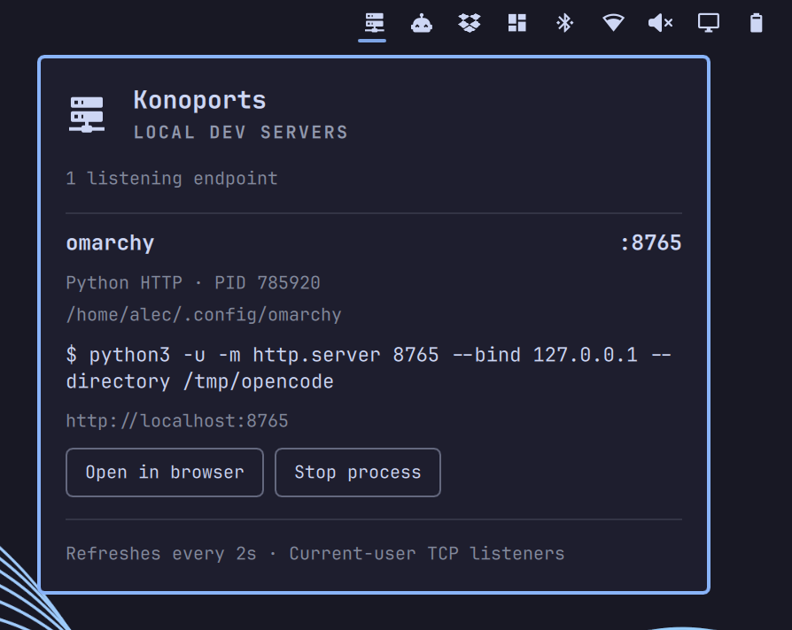

# Konoports

Local dev servers, one click away. Part of [Konochi](https://github.com/xvvhang/konochi),
a collection of native Omarchy plugins.

Inspired by [Portlivo](https://portlivo.com/), independently implemented for Linux
and Omarchy Quattro with Quickshell and Python's standard library.

## Screenshot

[](preview.png)

## Features

- Server icon appears only when dev servers are detected; otherwise it is hidden
  without reserving bar space.
- Left-click opens a live panel; Escape or an outside click dismisses it.
- Project folder, framework/runtime, listening address and port, PID, and command.
- Open the endpoint in your default browser.
- Stop a process and release its ports, with a second-click confirmation.
- Local-only `/proc` scanning every two seconds. No account, telemetry, HTTP
  probing, dependency installation, or elevated permissions.

## Installation

Requires **Omarchy Quattro**, Python 3.9+ with Linux pidfd support, and readable
`/proc` process/socket metadata.

Install from GitHub:

```sh
omarchy plugin add https://github.com/xvvhang/omarchy-konoports-plugin --enable
```

For local development, put this directory at
`~/.config/omarchy/plugins/konochi.konoports/`, then run:

```sh
omarchy plugin validate ~/.config/omarchy/plugins/konochi.konoports
omarchy plugin enable konochi.konoports
```

The widget is placed in the right section. Plugin code and bar layout hot-reload.

## Use

Click the bar's server icon. Each listening socket has **Open in browser** and
**Stop process** actions. Click Stop again within six seconds to confirm, or
choose Cancel. Stopping affects the **whole PID**, not just the selected port.
SIGTERM is followed by SIGKILL after 2.5 seconds if necessary; unsaved in-memory
work can be lost. A process supervisor may restart the server with a new PID.
Shared listeners can have multiple owners: stopping one may not release the port.
The next scan updates the list; action feedback is shown at the bottom.

The collector checks ownership, Linux process start time, socket inode, and port
before signaling. A pidfd pins the target identity during termination/escalation,
preventing accidental signaling of a recycled PID. No shell command is executed
from process metadata. The panel shortens executable/script paths (for example,
`node /…/vite/node/cli.js dev --force` becomes `vite dev --force`) while keeping
application arguments. Full commands remain available in diagnostic IPC output.
Commands are read from `/proc/PID/cmdline`, not shell history:
they show the running process invocation, not necessarily the original `npm run dev`
wrapper. Process titles may have been rewritten by the runtime.

## Detection and limitations

Recognizes Node, Bun, Deno, Python, PHP, Ruby, Java, Go and BEAM listeners,
common frameworks, and custom executables whose working directory has a project
manifest (e.g. `Cargo.toml` or `go.mod`). Editor/browser/agent internal APIs are
excluded. Detection is heuristic: some non-HTTP runtime listeners may appear and
unrecognized custom binaries may be missed. Opening a non-HTTP endpoint will not
produce a web page. HTTPS is inferred only from an explicit `--https` argument.

Only current-user TCP listeners in the current network namespace are supported.
Root/system processes, UDP, Unix sockets, remote servers, and container-internal
ports are not managed. Default/wildcard and standard loopback binds open as
`localhost` (including IPv6-only `::1` listeners). Other bound addresses are
preserved; non-loopback IPv6 URLs use brackets.
Permissions or hidden `/proc` metadata can limit discovery. The panel reports
collector errors instead of presenting a successful empty scan.

Process arguments can contain secrets. They are displayed locally and available
through the diagnostic IPC endpoint; redact screenshots before sharing.
The plugin runs unsandboxed with your user permissions.

## Diagnostics and development

```sh
python3 -B collect.py --once
python3 -B -m unittest -v test_collect.py
omarchy-shell konochi.konoports status
omarchy-shell shell summon konochi.konoports
omarchy-shell shell hide konochi.konoports
```

Tests create their own ephemeral listeners and only terminate their own children.
See [TESTING.md](TESTING.md) for validation coverage.

## Removal

```sh
omarchy plugin disable konochi.konoports
# Back up local development files before removal:
omarchy plugin remove konochi.konoports
```

Disabling/removing Konoports does not stop any dev servers. MIT licensed.
